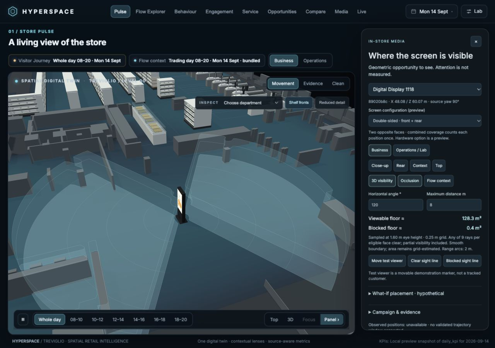
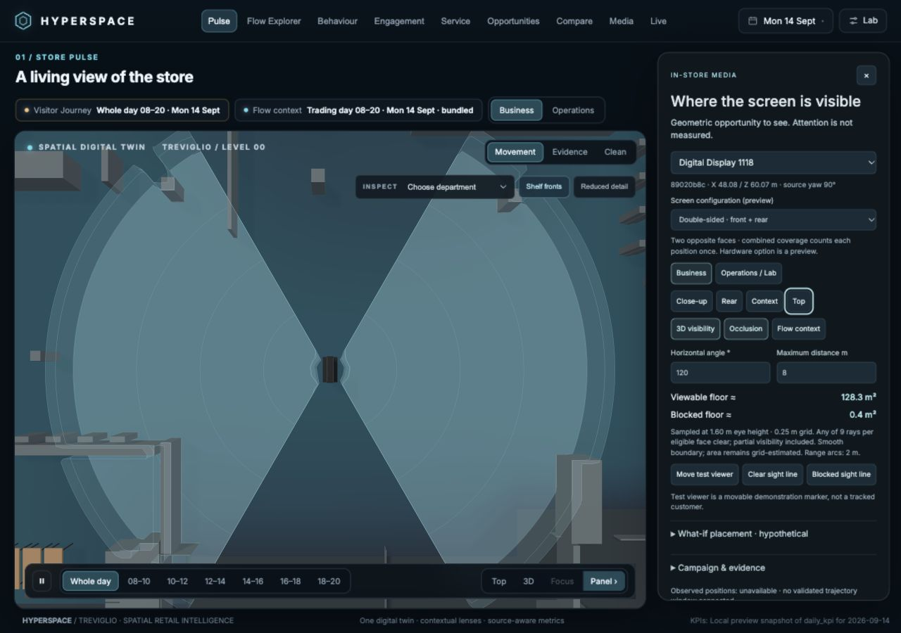
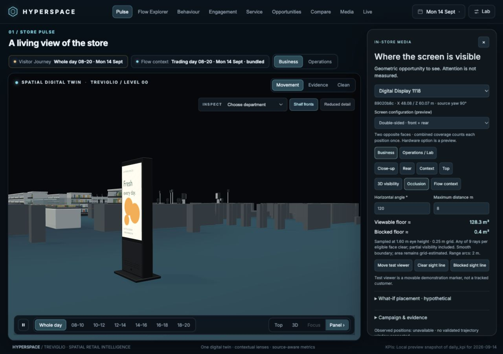
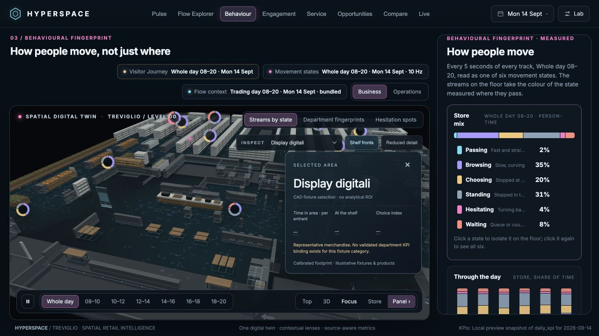
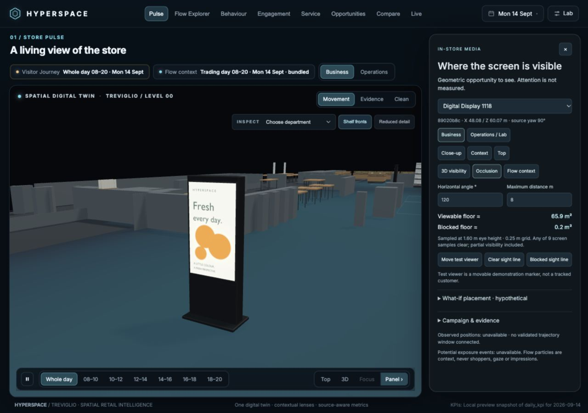
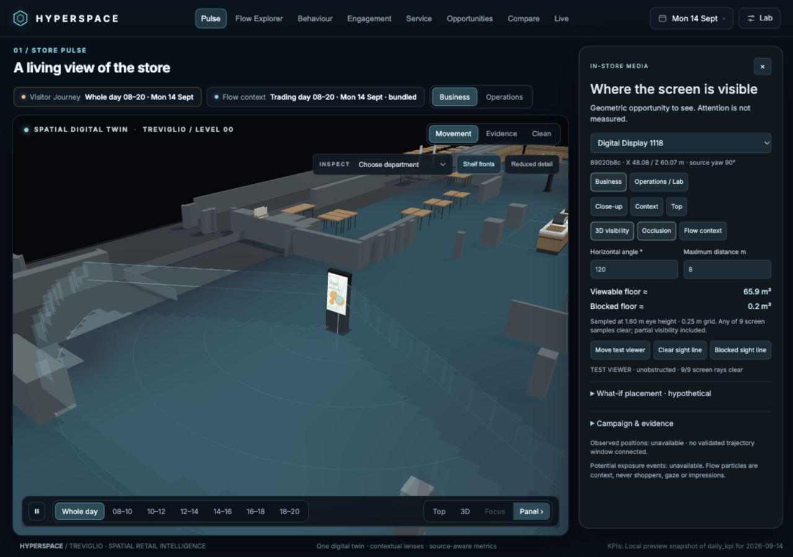
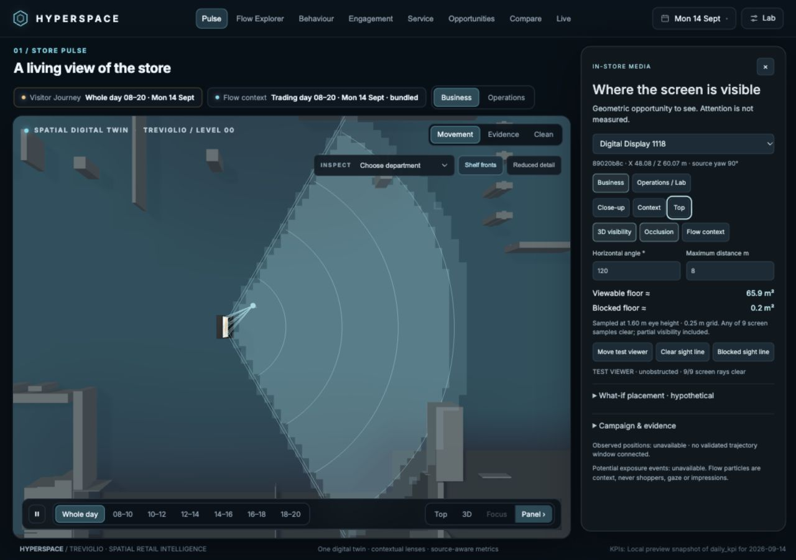
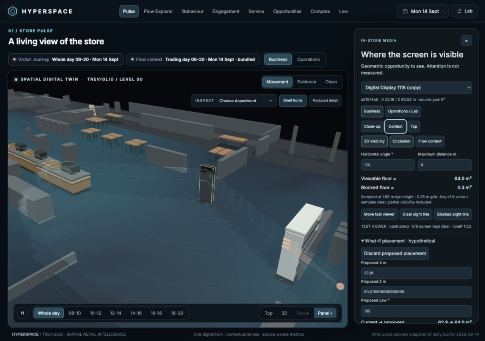
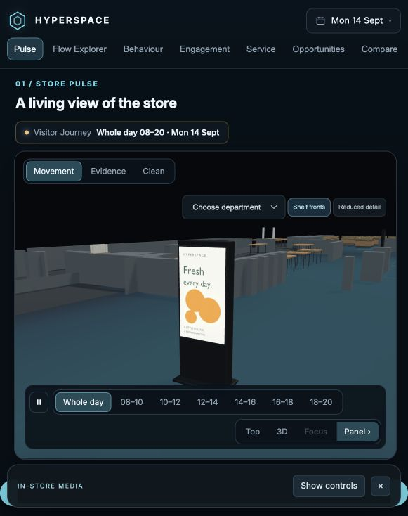

# Digital totem and geometric visibility — local implementation

Date: 2026-10-13. Preview: http://127.0.0.1:5183/flowfield/index.html?slice=trading&question=moved

Open **Inspect → Display digitali**, or click either physical screen. Choose a device in the contextual inspector. Close-up, Context and Top move the existing camera; orbit and zoom remain available. On narrow windows, **Show controls / Minimise** keeps the scene usable.

## Double-sided and smooth-boundary update

The first implementation was single-sided. The inspector now offers **Screen configuration → Single-sided / Double-sided**, independently for each totem during the local session. Double-sided activates a second physical screen facing the opposite direction, with its own nine rays, angle gates and occlusion checks. Position samples and floor cells are counted once in the union of both faces. This is a hardware preview until the installed equipment is confirmed; source IDs and positions remain unchanged. Both faces currently share the campaign preview. A new **Rear** camera button shows the back screen.

The former stepped border came from rendering 25 cm square grid cells as floor tiles and extruding three height slices as voxels. The displayed boundary now uses continuous angle/distance constraints, interpolated triangle contours and a marching-tetrahedra surface through height samples at most 15 cm apart. Obstruction transitions are refined by seven bisection steps, rather than blurred through fixtures. Curves are finely tessellated; genuine corners and visibility discontinuities around obstructions remain. This remains an approximate model, not exact optical simulation. The independent 25 cm grid still supplies the reported area, so smoother rendering does not manufacture more precise measurements.

The new SkyRig Blender variant is `retail/totem/digital-totem-double.blend`; runtime asset `frontend/public/flowfield/retail/totem/digital-totem-double.glb`. It has **7 meshes, 5,832 triangles, 934,704 bytes**, two opposing emissive screen surfaces and a lower rear service panel/vents that do not cover the display. Reproduce with the existing generator plus `--sides 2` and a separate output directory. Validate with `node scripts/retail/verify_totem.mjs --double`. The original single-sided GLB remains intact.

New code: `media-visibility-surface.js` separates display meshes from coverage accounting; `media-visibility-surface.test.mjs` checks circular accuracy, opposing faces, rotation and retained shelf shadows. Geometry tests additionally check rear-face occlusion and counts without duplication. **55 focused tests pass.** Updated double-sided asset validation is in `double-sided/asset-validation.json`. The double-sided top view measured 60.2 fps and 4.0 ms main-frame CPU, with 46 draw calls and 390,196 total scene triangles.





Browser verification on device two: with two faces enabled at the original yaw, the test eye at X 15.375 / Z 55.875 reports **rear face · obstructed · 0/9 rays clear · Shelf 1122**. Total visible floor is 126.8125 m² under the default assumptions. See `double-sided/browser-evidence.json` and `screens/double-sided-rear-occlusion.jpg`. The first device’s double-sided option remained selected after switching to the second device and back.

## Delivered

- A freestanding, integrated black commercial kiosk, generated and rendered in Blender 5.2.1 LTS on the existing SkyRig host through the established SSH export pipeline. The Blender MCP listener was unavailable; no new service was installed.
- Editable source: `retail/totem/digital-totem.blend` (46 product components, packed campaign texture). Generator: `scripts/retail/generate_totem.py`.
- Runtime: `frontend/public/flowfield/retail/totem/digital-totem.glb`, 1,081,964 bytes, six material-batched meshes, 8,462 triangles, one embedded texture. The two placements share geometry.
- Configurable enclosure/screen dimensions and explicit viewing assumptions in `retail/totem/config.json` under the public Flowfield directory. Satin enclosure, bevels, rear service panel, ventilation, cable exit, weighted base and floor pads. Dedicated emissive screen supports local image/video preview without transmitting campaign files.
- Pale-cyan 3D potential-visibility shell, sampled floor projection, 2 m range arcs, nine-ray screen visibility, solid CAD obstruction proxies, movable test eye, Business / Operations controls and hypothetical placement comparison.
- Source-gated position-sample association utility, deliberately unconnected when no validated trajectory window is available. No synthetic audience metrics.

The exact requested photograph and separate detailed specification were **not available**. The supplied task named `ASTRA_DIGITAL_TOTEM_AND_VISIBILITY_PROMPT.md` and three files under `references/`; none were found at those paths or in the searched attachments/Desktop/Downloads. This implementation follows the written brief. It is not a verified match to an unseen reference or a manufacturer-certified model.

## Placement and dimensions

| Device | CAD index | Installed X / Z (m) | Source yaw |
|---|---:|---|---:|
| `89020b8c-d9d0-428b-9a7b-e62e1e25f123` | 1117 | 48.08 / 60.07 | 90° |
| `a51574e5-33c4-4616-b093-73a3faea27cd` | 1118 | 22.18 / 60.02 | 0° |

Original IDs, CAD vertices and centres are unchanged. Yaw comes from the original fixture CSV, rather than the old generic asset's width/length normalisation. Front/back must still be confirmed on site. Blender front −Y exports to glTF +Z. Runtime scale is one metre per unit; the new enclosure is not stretched to the old thin CAD marker.

Enclosure: 0.745 m wide × 1.94 m tall × 0.18 m deep. Base envelope: 0.80 × 0.46 m. Active screen: 0.685 × 1.218 m, diagonal 55.016 inches; centre Y 1.25 m, front Z 0.096 m. These are plausible design assumptions, not measurements. The GLB minimum Y is zero. Both installed footprints pass the current proxy collision check.

Manufacturer changes require updating the configuration, regenerating the GLB/Blender source and re-running the asset checks. Review accessory details in the generator if enclosure proportions change substantially.

## Measurement contract

**Geometric opportunity:** a viewer is in front of the screen, within the configured Euclidean distance from screen centre, inside horizontal/vertical angular envelopes about the front normal, and inside the assumed eye-height band. Defaults: 120° horizontal, 100° vertical, 0.5–8 m distance, eye heights 1.2–1.8 m, selected eye 1.6 m. Optional legibility distance further limits range; it is an assumption, not a text-reading model.

**Occlusion:** nine rays target an inset 3 × 3 grid on the actual screen rectangle. Segment intersections use exact registered CAD polygons extruded to illustrative heights. All nine clear = unobstructed; one to eight = partial; zero = blocked. The test eye shows this fraction and the first obstruction name. Rays stop at the obstruction. This is a finite sampling approximation, not exact visible screen area.

**Floor area:** a 0.25 m grid, evaluated at selected eye height, clipped to the venue bounding rectangle and excluding fixture interiors. A cell contributes its entire area when its centre qualifies. “Viewable floor” includes partial visibility and is explicitly approximate. It is not guaranteed walkable circulation area: no validated walkability mask is available.

**3D shell:** a continuous-boundary surface through the assumed eye-height band, generated by marching tetrahedra from 25 cm horizontal samples and height spacing of at most 15 cm. Eye-height caps and the floor use interpolated triangle contours. Obstruction crossings are refined against the visibility predicate. This is a sampled eye-opportunity volume, not a surveillance camera cone. Thin angle limits/range arcs are guides; they do not claim visibility through obstacles.

**Obstacle assumptions:** 1,117 source CAD polygons plus the other physical totem. Heights follow illustrative department modules; unidentified fixtures default to 1.15 m, named walls/columns to 2.8 m. Heights are not surveyed. Transparent fixtures are conservatively solid. The broad phase filters nearby bounds before ray tests. Decorative merchandise meshes never enter the visibility calculation. `build_totem_metadata.py --check` reproduces the proxy list.

**Observed positions:** `observedPositions()` accepts only a named, explicitly validated, venue-matched source with a finite ordered time window, finite positions/timestamps and `quality: valid`. It counts valid position samples, never distinct people. Eye height remains assumed. Counts are invalidated when assumptions, selected device or proposed geometry change. No data feed is connected in this delivery: the available live-position category endpoint returned HTTP 500, and existing selected/downsampled trajectory replays are not a validated full-window audience source.

**Potential exposure opportunities:** unavailable; no temporal event derivation is claimed. **Actual attention, gaze, impressions, unique shoppers, conversion, sales lift and ROI:** not measured or inferred. Animated flow is visual context only. A separate parallel `media/` data pack and Media lens appeared during this work; neither its metrics nor its placement logic are imported by this geometric inspector.

## What-if and demonstration

Create a ghost under **What-if placement · hypothetical**, then edit X, Z or yaw. The installed model and source configuration stay unchanged. Current/proposed area uses the same settings. Warnings identify overlap with obstruction proxies, including crossing edges. This is geometric comparison, not a recommendation based on attention or sales.

Reproduce the shelf example:

1. Select **Digital Display 1118 (copy)** with default 120° / 8 m assumptions.
2. Create a ghost and set proposed yaw to 180°.
3. Choose **Blocked sight line**, then **Context**.
4. The eye at X 15.375, Z 55.875, Y 1.6 has 0/9 clear rays, stopped by **Shelf 1122**.
5. Disable Occlusion: the same eye has 9/9 clear rays. Restore Occlusion to see the shelf block them again.

Default installed device one has approximately 65.94 m² visible / 0.19 m² blocked floor. Device two has 62.81 m² visible, including 2.75 m² partial cells, and no fully blocked cells at the default selected eye height. Its hypothetical 180° rotation has 64.00 m² visible / 0.31 m² blocked. These figures are deterministic geometry under the stated assumptions, not audience estimates.

## Verification

- `node --test frontend/public/flowfield/*.test.mjs`: **55 passed, 0 failed**. Includes front/back and distance gates, transformed rotation, partial/complete shelf occlusion, low obstacles, non-convex proxies, bounds, invalid controls/time windows and crossing-footprint collision.
- `node scripts/retail/verify_totem.mjs`: **pass**. Six meshes, 8,462 triangles, embedded emissive texture, floor contact, physical dimensions, +Z screen normal, both original IDs/CAD polygons/centres.
- `python3 scripts/retail/build_totem_metadata.py --check`: **pass**, 1,117 reproducible proxies.
- Existing supermarket asset verification: **pass** for 42 department assets, 113 placements; existing Frutta hashes retained. See `department-preservation.json`.
- Syntax checks for new renderer and touched integration JS, and scoped `git diff --check`: pass.
- Browser: tested both devices, contextual selection and direct mesh picking, fly-in/close-up/context/top, angle change, occlusion on/off, Lab proxy controls, movable eye, hypothetical rotation, image and MP4 campaign preview, close and return to Behaviour/Fruit, narrow 581 × 734 and desktop 1280 × 900. PNG and MP4 were local file previews. The MP4 was a one-second test clip made from the original campaign image; codec/playback path tested, not a long-running campaign soak test.
- No browser console errors in the checked final session. Live data fallback/API availability remains a separate environment limitation.
- Broader `tsc --noEmit`: **fails in existing React `src/` files outside this change**, including unused imports and optional-coordinate type errors. Full output is `frontend-typecheck.txt`; this does not constitute a successful full frontend production build.

Initial single-sided/voxel-version performance snapshots in the visible in-app browser: close-up about 60 fps, 4.55 ms measured main-frame CPU, 59 draw calls / 379,248 scene triangles. Visibility worker recomputation varied about 55–226 ms in recorded runs; cold total computation/UI assembly reached about 407 ms. Work runs in a module worker and recalculates on changes, not every animation frame. The smooth-boundary revision increases change-time computation: recorded double-sided worker runs took about 0.86–0.88 seconds, with UI/transfer totals around 0.91–1.18 seconds, while the scene remains interactive. These are local snapshots, not a benchmark across hardware. See raw `browser-evidence.json` and `asset-validation.json`.

## Rebuild

From the repository root:

```sh
python3 scripts/retail/build_totem_metadata.py --check
node --test frontend/public/flowfield/*.test.mjs
node scripts/retail/verify_totem.mjs
```

On the existing SkyRig machine, stage the generator, configuration and existing retail manifest in `C:/Users/Administrator/HyperspaceRetail/`, then run:

```powershell
& 'C:/Program Files/Blender Foundation/Blender 5.2/blender.exe' -b --python C:/Users/Administrator/HyperspaceRetail/generate_totem.py -- --config C:/Users/Administrator/HyperspaceRetail/config.json --out C:/Users/Administrator/HyperspaceRetail/totem-v2 --manifest C:/Users/Administrator/HyperspaceRetail/manifest.json
```

This resets a separate Blender scene, exports the GLB, retains editable source components and creates four previews. The verified run used Cycles with 48 samples and denoising on CPU; GPU rendering is not claimed. Copy the GLB/campaign to the public totem directory, the `.blend`/stats to `retail/totem`, and previews here. Do not overwrite the department manifest or old shared assets.

Local server used the installed Node 18 binary and Vite: `node node_modules/vite/bin/vite.js --host 127.0.0.1 --port 5183 --strictPort`, from `frontend/`.

## Files and integration ownership

- `frontend/public/flowfield/media-visibility-geometry.js`: pure geometric visibility, proxy intersections, sample-source validation and placement overlap.
- `frontend/public/flowfield/media-visibility-geometry.test.mjs`: deterministic geometry and source-gating regression tests.
- `frontend/public/flowfield/media-visibility-worker.js`: asynchronous footprint/continuous-surface construction and baseline cache.
- `frontend/public/flowfield/media-visibility-surface.js`: smooth floor/3D contour construction with refined occlusion boundaries.
- `frontend/public/flowfield/media-visibility-surface.test.mjs`: envelope accuracy and obstruction-preservation tests.
- `frontend/public/flowfield/retail/totem/digital-totem-double.glb`: two-face optimized kiosk variant.
- `retail/totem/digital-totem-double.blend` and `stats-double.json`: editable double-sided source and export metadata.
- `double-sided/`: the variant’s SkyRig previews and asset validation.
- `frontend/public/flowfield/media-visibility.js`: shared scene asset, selection, cameras, inspector, campaign preview, ghost and test eye.
- `frontend/public/flowfield/media-visibility.css`: contextual desktop inspector and collapsible narrow layout.
- `frontend/public/flowfield/retail/totem/config.json`: physical assumptions, exact installed identities/anchors and default viewing controls.
- `frontend/public/flowfield/retail/totem/occluders.json`: reproducible illustrative-height metadata for the existing CAD polygons.
- `frontend/public/flowfield/retail/totem/digital-totem.glb`: optimized six-mesh asset.
- `frontend/public/flowfield/retail/totem/campaign-fresh.png`: original portrait campaign texture.
- `retail/totem/digital-totem.blend`: editable source and studio setup.
- `retail/totem/stats.json`: SkyRig export metadata.
- `scripts/retail/generate_totem.py`: dedicated Blender generator and render/export pipeline.
- `scripts/retail/build_totem_metadata.py`: deterministic CAD proxy metadata builder/checker.
- `scripts/retail/verify_totem.mjs`: GLB and identity/calibration checks.
- `frontend/public/flowfield/main.js`: creates media module, routes object/eye picks, supplies fly/flow callbacks, hides legacy CAD wire while inspecting media, exposes read-only camera/performance diagnostics.
- `frontend/public/flowfield/retail-twin.js`: suppresses old Display digitali visuals only after the replacement loaded successfully; leaves old assets as fallback.
- `frontend/public/flowfield/workspace.js`: routes Display digitali selection to the contextual inspector; closes it on other selections/lenses; prevents startup overview reset overriding an active media selection.
- `frontend/public/flowfield/index.html`: adds media visibility stylesheet.
- This documentation directory: screenshots, SkyRig previews and validation evidence.

The working tree already contained parallel changes to main/workspace and other files. Do not attribute the entire repository diff to this task. No changes were made to the existing `field.js`, `layers.js`, slices, Frutta assets, other department GLBs or KPI/trajectory calculation code. No push, commit or production deployment was performed for this task.

## Original single-sided visual evidence (before the smooth-boundary update)

Before, actual application (wider context; not a matched-camera comparison):



After, actual application:







SkyRig studio renders: [front three-quarter](front-three-quarter.png), [side](side.png), [rear](rear.png). The [Blender in-store preview](in-store.png) uses nearby mapped fixture proxies, not the full detailed supermarket; the browser captures above are the actual application.

## Remaining limits

Exact photo matching awaits the named references. Confirm enclosure dimensions, installed front direction and obstruction heights on site. Calibrated trajectories and a documented temporal association method are needed before exposing audience-related counts. Coverage is a sampled geometric model with illustrative heights, not an audited media measurement. No production build/deploy claim is made.
